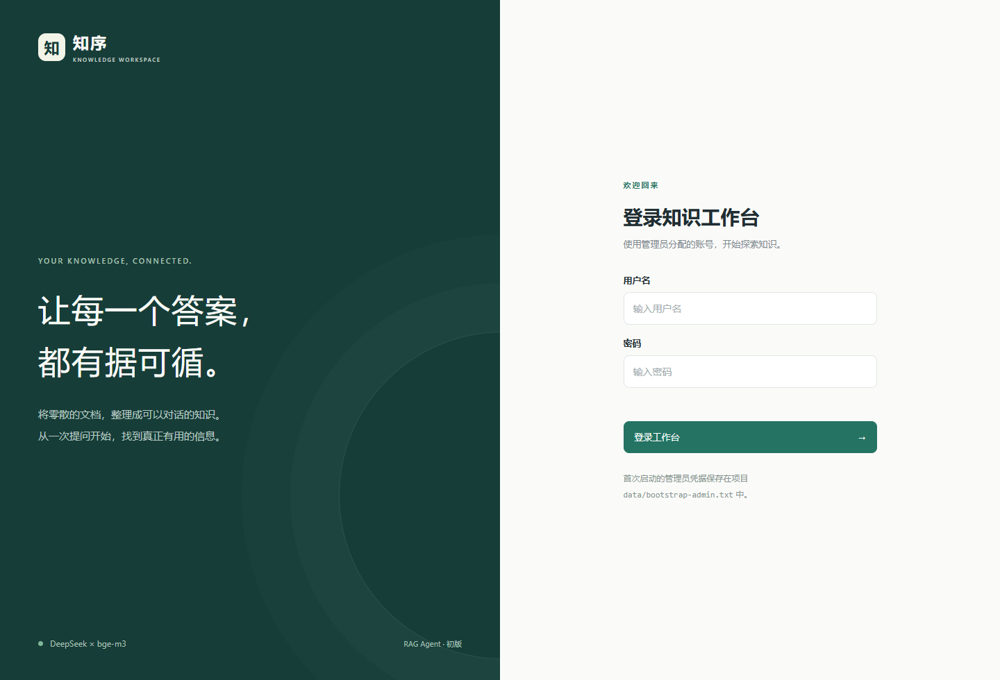
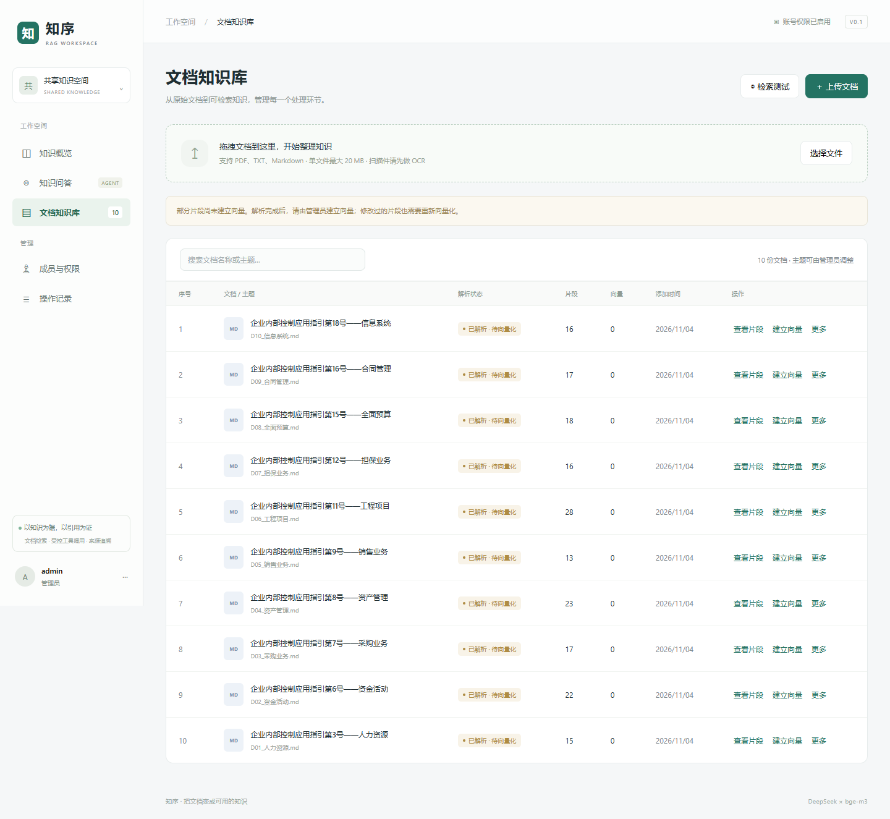
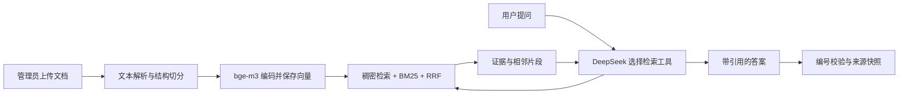

# 知序 · RAG Agent

面向企业制度与共享文档的中文知识库问答应用。使用 **DeepSeek 工具调用 + bge-m3 向量检索**，提供管理员 / 只读成员权限、文档管理、结构切分、混合检索和可点击的回答来源。

这是适合学习、演示和小规模知识库验证的初版，采用 FastAPI、原生 HTML / CSS / JavaScript、SQLite 与 NumPy，无需前端构建、Docker 或外部向量数据库。

## 功能

| 功能 | 当前实现 |
| --- | --- |
| 权限 | 管理员管理用户、文档与片段；只读成员浏览和提问；会话按账号隔离 |
| 文档 | 上传文本型 PDF、TXT、Markdown；查看主题、文档序号、片段数与有效向量数 |
| 切分 | 识别条款、层级标题、问答、流程、清单、表格与代码；长度只作为兜底上限 |
| 检索 | bge-m3 的 1024 维稠密向量 + BM25 + RRF，可限定单份文档 |
| Agent | 必须先检索，可改写查询、多轮检索、读取相邻片段；有轮次与超时限制 |
| 来源 | 正文按首次出现连续编号 S1、S2…；下方显示文件名和真实片段号，保留引用快照 |
| 评测 | 10 份官方公开资料、44 道业务问题、预期答案和 68 处依据，提供离线校验与检索统计 |

## 界面





截图来自独立演示数据库，使用公开测试资料。知识库截图展示已解析、待向量化状态，不代表模型效果或评测成绩。

## 快速开始

准备 Python **3.11 或 3.12**、可用的 DeepSeek API Key，以及能下载 Python 依赖和 bge-m3 的网络。Git 只在克隆和提交代码时需要；Node.js 只用于前端测试。

### 1. 下载并进入项目

从 GitHub 下载 ZIP 后解压，或执行下列命令：

```powershell
git clone https://github.com/wswwhcs9421/zhixu-rag-agent.git
cd zhixu-rag-agent
```

以下命令都在包含 `run.py` 的项目根目录执行。

### 2. 首次安装

Windows / PowerShell：

```powershell
python -m venv .venv
.\.venv\Scripts\python.exe -m pip install -r requirements-local-model.txt
Copy-Item .env.example .env  # 仅首次复制，已有配置不要覆盖
```

`requirements-local-model.txt` 已包含基础依赖。若使用已有的 bge-m3 Embedding API，只安装 `requirements.txt`，再按[配置手册](docs/usage.md#方式-b调用已有-embedding-api)设置 API 模式。

### 3. 配置模型

编辑 `.env`，填写自己的密钥：

```dotenv
DEEPSEEK_BASE_URL=https://api.deepseek.com
DEEPSEEK_API_KEY=填写你自己的密钥
DEEPSEEK_MODEL=deepseek-flash
BGE_MODE=local
BGE_MODEL=BAAI/bge-m3
BGE_DEVICE=cpu
```

`deepseek-flash` 是开发时使用的配置示例，模型 ID 以服务商当前提供的实际名称为准；接口需要支持 `/chat/completions` 与函数工具调用。密钥管理网页不是 API 地址。

bge-m3 首次建立向量时下载。若下载不稳定，可先执行 `.\.venv\Scripts\python.exe scripts/download_bge_m3.py`，再把 `BGE_MODEL` 改为 `./data/models/bge-m3`。该下载脚本固定版本并验证哈希；下载与组装建议预留至少 5 GB 磁盘空间。CPU 可以运行，初次加载和编码可能较慢。

### 4. 启动并登录

```powershell
.\.venv\Scripts\python.exe run.py
```

打开 **<http://127.0.0.1:8000>**。首次启动默认用户名 `admin`，随机密码保存在本机 `data/bootstrap-admin.txt`，登录后在账号菜单修改密码。发布版本不附带现有账号或通用固定密码。

以后重新启动，在项目根目录执行同一条 `run.py` 命令；按 `Ctrl+C` 停止。修改 `.env` 后需要重启。

### 5. 导入并提问

1. 进入「文档知识库」，上传文档，等待解析完成。
2. 点击「查看片段」核对原文，再点击「建立向量」。
3. 状态变为「可检索」后，先用「检索测试」检查召回，再去「知识问答」提问。
4. 点击 S1 等引用，查看文件名、原始片段序号和回答时的原文快照。

可用 `evaluation/enterprise_v1/corpus/` 中的 10 份公开资料试用。**只上传 corpus 中的资料，不上传题库与标准答案**，以免污染评测。

Linux / macOS 的手动启动步骤见[使用手册](docs/usage.md#linux--macos-手动启动)。Windows 也可运行 `powershell -ExecutionPolicy Bypass -File .\start.ps1` 完成基础安装并启动；该脚本不自动安装本地模型推理依赖。

## 工作原理



每个文本片段对应一个 1024 维稠密向量；数据库同时保存文本、片段顺序和章节路径。S1 是本次回答的来源序号，和原文中的「片段 7」是两套不同编号。详见[架构说明](docs/architecture.md)。

## 文档与验证

- [配置、权限、切分规则、备份与使用手册](docs/usage.md)
- [常见问题与故障排查](docs/troubleshooting.md)
- [测试、贡献与代码修改](CONTRIBUTING.md)
- [测试集与命中率统计方法](evaluation/enterprise_v1/README.md)
- [GitHub 上传与发布目录说明](docs/github-publishing.md)
- [安全范围与问题报告](SECURITY.md)
- [第三方资料与许可说明](NOTICE.md)

不需要真实模型或 API Key 的测试：

```powershell
.\.venv\Scripts\python.exe -m pip install -r requirements-dev.txt
.\.venv\Scripts\python.exe -m pytest
node --test tests/chat-format.test.cjs
node --check web/app.js
```

GitHub Actions 已配置 Windows / Ubuntu、Python 3.11 / 3.12 的后端测试，以及前端检查和数据集校验。配置工作流不等于已在 GitHub 上运行成功；本地验收结果见 [RELEASE_CHECKLIST.md](RELEASE_CHECKLIST.md)。

## 项目边界

当前为一个共享知识库，没有部门或文档级权限、多租户隔离、OCR、Word / Excel 解析、学习型重排器或大规模向量索引。向量保存在 SQLite，通过 NumPy 检索，适合小规模验证。引用存在性校验不等于验证每条结论都正确，重要结论应核对原文。

使用远程模型时，问题、相关会话与召回片段会发送给配置的服务商。默认只监听本机；公网部署还需自行配置 HTTPS、备份和访问管理。这里的测试通过不代表生产部署认证，也不代表 DeepSeek / bge-m3 的真实命中率。

发布目录不包含 `.env`、用户数据、原始上传文件、本地模型、虚拟环境或个人文档。新用户需要自行配置模型并导入资料。原创应用代码采用 [MIT 许可证](LICENSE)；第三方资料的来源及权利单独见 [NOTICE.md](NOTICE.md)。
